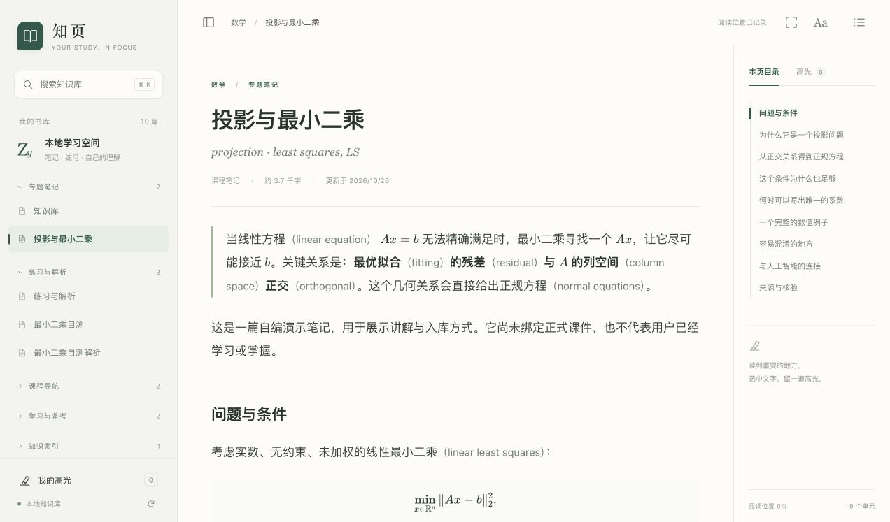

# 知页 Zhiye

**把课程材料、AI 讲解与自己的理解，整理成可持续积累的本地知识库。**

[English](README.en.md) · [快速开始](#快速开始) · [完整案例](知识库/数学/投影与最小二乘.md) · [贡献指南](CONTRIBUTING.md)

知页是一套以 Markdown 为基础的学习工作区，包含可复用的 AI 协作规则、课程与练习模板，以及一个支持公式、搜索和高光的本地阅读器。适合数学、人工智能等需要推导、概念辨析和习题训练的课程，也可以按自己的学科调整。



## 它包含什么

| 组成 | 用途 |
| --- | --- |
| 学习协作规则 | 以材料为依据讲解，记录来源和条件；区分内容核验与个人掌握 |
| 课程讲解 skill | 中文解释与英文术语对照、必要推导、按需提示和知识整理 |
| Markdown 模板 | 课程主页、概念笔记、习题、实验、考试准备与学习记录 |
| 知页阅读器 | 数学公式、全文搜索、页内目录、三色高光、批注、主题与阅读位置 |
| 一个完整案例 | “投影与最小二乘”的笔记、自测和独立解析，均为自编内容 |

阅读器本身不调用模型，不需要 API Key。AI 辅导由你选择的助手提供；阅读器也可以独立使用。笔记是普通文件，没有专用数据库格式。

## 快速开始

需要 **Python 3.9 或以上**和现代浏览器。日常阅读无需安装 Python 包或前端依赖。

```bash
git clone https://github.com/moimksa/zhiye.git
cd zhiye
python3 阅读器/launch.py
```

浏览器会打开本地阅读器。默认地址为 `http://127.0.0.1:8765`；如端口已被占用，会尝试相邻端口。macOS 也可双击根目录的 `打开阅读器.command`；Windows 可将命令中的 `python3` 换成 `py -3`。

如果希望在终端中直接启动和停止服务：

```bash
python3 阅读器/server.py
```

按 `Ctrl+C` 停止。详细操作、备份与恢复方式见 [阅读器说明](阅读器/README.md)。

## 从案例到自己的课程

1. 阅读 [投影与最小二乘](知识库/数学/投影与最小二乘.md)，体验公式、目录、搜索和高光。
2. 打开 [配套自测](练习/示例/最小二乘自测.md)，作答后再看 [解析](练习/示例/最小二乘自测解析.md)。
3. 初始化自己的学习空间：`python3 scripts/init_workspace.py`。重复运行不会覆盖已有文件。
4. 将自己的课件、笔记和作答放入 `个人资料/`，从 [模板](模板/README.md) 复制需要的格式。
5. 在支持读取项目文件的 AI 助手中打开此目录，让它读取 [AGENTS.md](AGENTS.md)。支持项目 skills 的助手还可使用 [course-explainer](.agents/skills/course-explainer/SKILL.md)。

可以直接发出这样的请求：

> 读取本项目的 AGENTS.md 和我的学习档案。结合我提供的材料，讲清这一步为什么成立，保留必要条件和英文术语。

> 带我做这道题。先给一个提示，等我作答后再判断下一步。

> 把刚才的推导整理成笔记，保存到个人资料/知识库，标明来源。我的掌握状态只根据实际作答记录。

## 文件结构

```text
zhiye/
├── AGENTS.md                 AI 协作约定
├── .agents/skills/           可复用讲解 skill
├── 模板/                     空白模板
├── 课程/示例课程/            案例导航
├── 知识库/数学/              自编案例笔记
├── 练习/示例/                自测与解析
├── 学习系统/                 使用方法
├── 备考/                     备考入口
├── 个人资料/                 初始化后创建，Git 默认忽略
├── 阅读器/                   本地服务、前端与测试
└── scripts/                  初始化与发布检查
```

## 个人资料与公开内容

公开仓库只包含通用框架、程序、空白模板和自编案例。真实学习档案、姓名、作业提交、考试安排、原始课件和阅读记录不包含在发行内容中。

`个人资料/`、`阅读器/data/`、历史备份、环境文件和常见原始文档格式已加入忽略规则。默认使用时，阅读记录保存在本机；阅读器不包含账号、遥测或云同步。笔记中的外部链接和远程图片仍会访问对应网站。将资料交给外部 AI 服务时，适用该服务的数据处理方式。

**Git 忽略规则不等于自动脱敏。** 已被跟踪的文件仍可能提交；发布修改前请检查差异并运行 `python3 scripts/check_public.py`。详细边界见 [数据与发布说明](docs/privacy.md)。

## 开发与验证

运行时使用 Python 标准库和已随仓库分发的前端资源。开发检查另需 Node.js 20 或以上：

```bash
cd 阅读器
npm ci
npm test
```

测试覆盖本地文档检索、高光持久化、访问边界、公式渲染和高光重定位。根目录运行 `python3 scripts/check_public.py` 检查公开文件中的常见敏感内容与本地链接。贡献代码时请同步更新对应测试。

## 许可

项目原创代码、文档、模板与自编案例采用 [MIT License](LICENSE)。随附的 Markdown、公式渲染和清理库保留各自许可证，见 [第三方说明](THIRD_PARTY_NOTICES.md)。本项目不附带学校课件、教材、真实作业提交或官方试题。
